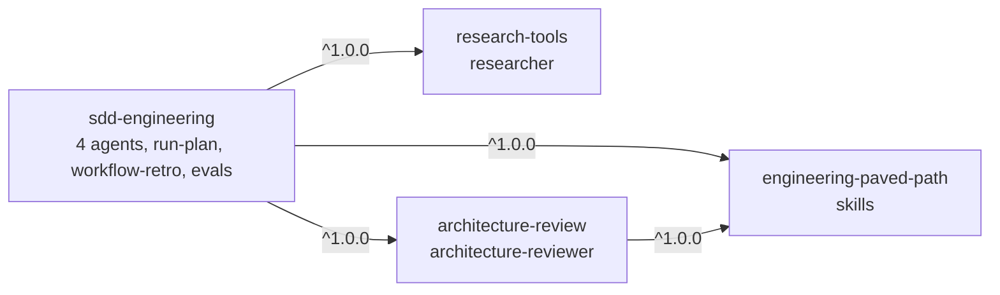

# SDD plugin suite specification

Status: v2.1 (implementation started; see section 12 for what is built)

Defines the first four plugins of this marketplace: **Spec Driven Development (SDD) Engineering** and the three plugins it depends on. Sources: the L08 lab brief (`dev-digest/hw-criteries/L08-Lab-marketplace.pdf`, steps 1-10) and the working setup in the local `dev-digest` repository (`.claude/agents/`, `.claude/skills/`, `.claude/commands/implement.md`, `docs/sdd-workflow.md`). Original repository: <https://github.com/avelvi/dev-digest/tree/dev> (branch `dev`, commit `fae4c27`; the local checkout used for this spec is at that commit and has no uncommitted changes under `.claude/`). Upstream repositories of the third-party skills are still to come (section 10.1).

## 1. Decisions

| Topic | Decision |
|---|---|
| Plugins | 4: `sdd-engineering` plus dependencies `engineering-paved-path`, `research-tools`, `architecture-review` |
| Reuse | Reusable parts are separate plugins, declared in `dependencies`. Nothing outside a plugin directory exists after install (`../shared` does not work), so no local copies |
| Versioning | SemVer in `plugin.json`, tags `<plugin>--v<version>`, a `CHANGELOG.md` per plugin ([RELEASES.md](RELEASES.md)) |
| DevDigest coupling | Removed. DevDigest paths become explicit inputs (section 5) |
| Not carried over | Product specs, secrets, cache, DevDigest-specific instructions |
| Language | Plugin content in English, like the rest of this repo |
| Step 1 of the lab (repo, `README`, `CONTRIBUTING`, `CODEOWNERS`, `PLUGIN-GUIDELINES`, `SECURITY`, `RELEASES`) | Already done in this repository |

## 2. Plugin map



| Plugin | Provides | Depends on |
|---|---|---|
| `sdd-engineering` ("Spec Driven Development Engineering") | agents `spec-creator`, `implementation-planner`, `implementer`, `plan-verifier`; skills `run-plan`, `workflow-retro`; `evals/`; README and CHANGELOG | the other three, range `^1.0.0` |
| `engineering-paved-path` | React, Fastify, architecture, testing and security skills (Next.js not bundled, see 4) | none |
| `research-tools` | read-only agent `researcher` | none |
| `architecture-review` | generalized agent `architecture-reviewer`, `rules/`, `references/` | `engineering-paved-path` `^1.0.0` (confirmed) |

All four are installable on their own; installing `sdd-engineering` pulls the other three automatically.

## 3. Layouts

```
plugins/sdd-engineering/
├── .claude-plugin/plugin.json            # name, description, author, license, dependencies
├── agents/{spec-creator,implementation-planner,implementer,plan-verifier}.md
├── skills/
│   ├── run-plan/{SKILL.md,scripts/sdd-manifest.sh}
│   ├── workflow-retro/{SKILL.md,scripts/collect.py}     # disable-model-invocation: true
│   ├── mermaid-diagram/SKILL.md
│   └── engineering-insights/SKILL.md
├── evals/<case>/{prompt.md,graders/*.md} # claude plugin eval format, see 8.1
├── README.md                             # how the parts work together (section 7)
├── CHANGELOG.md                          # versions and releases
└── LICENSE

plugins/engineering-paved-path/   skills/{react-best-practices,fastify-best-practices,onion-architecture,frontend-architecture,react-testing-library,security}/...
plugins/research-tools/           agents/researcher.md
plugins/architecture-review/      agents/architecture-reviewer.md, rules/, references/
(each also: .claude-plugin/plugin.json, README.md, CHANGELOG.md, LICENSE)
```

`sdd-engineering/plugin.json` dependencies (bare names resolve inside this marketplace; ranges resolve against `<plugin>--v<version>` tags):

```json
"dependencies": [
  { "name": "engineering-paved-path", "version": "^1.0.0" },
  { "name": "research-tools", "version": "^1.0.0" },
  { "name": "architecture-review", "version": "^1.0.0" }
]
```

## 4. Skills: what goes where

| Skill | Source in dev-digest | Used by | Home |
|---|---|---|---|
| `react-best-practices` | local | implementer (UI items) | `engineering-paved-path` |
| `next-best-practices` | third-party: `vercel-labs/next-skills`, **no license** | implementer (UI items) | **not bundled** (see below) |
| `fastify-best-practices` | third-party: `mcollina/skills`, MIT | implementer (backend items) | `engineering-paved-path` (MIT text kept next to the skill) |
| `onion-architecture`, `frontend-architecture` | local | spec-creator, planner, implementer, architecture-reviewer | `engineering-paved-path` |
| `react-testing-library` | local | implementer / test work | `engineering-paved-path` |
| `security` | local | spec-creator, architecture-reviewer | `engineering-paved-path` |
| `mermaid-diagram`, `engineering-insights` | local | spec-creator, planner only | `sdd-engineering` (single user, so not shared) |
| `workflow-retro`, `run-plan` | local command/skill | the user | `sdd-engineering` |

Rules:

- A skill used by two or more plugins goes into a dependency plugin; a skill used by one plugin stays in it.
- `next-best-practices` is **not bundled**: the upstream repository publishes no license, so it cannot be redistributed. Users can install it from `vercel-labs/next-skills` themselves; the implementer uses it if present. Revisit if the upstream adds a license.
- Third-party skills (listed in `skills-lock.json`) are copied only after their license is checked; each keeps a `Source:` line (repo, path, pinned commit) and its license text.
- `typescript-expert`, `zod`, `drizzle-orm-patterns`, `postgresql-table-design` are outside the lab's list (React, Next.js, Fastify, architecture, testing, security) and stay out of 1.0.0. Adding them later is a MINOR release (10.2).
- Domain skills are never preloaded; the planner names them in each work item's `Skills to use` and the implementer loads them on demand through the `Skill` tool (preloading costs about 5-6K tokens per 20 KB skill per instance).

## 5. Packaging rules for `sdd-engineering`

1. **No DevDigest paths.** Every location becomes an explicit input, either a skill argument or one question asked once per run, with a documented default.

   | Was hard-coded | Now |
   |---|---|
   | Five named modules, `server/`, `client/` | Read from the project's `AGENTS.md` map, or asked |
   | `scripts/check.sh quick/full` | `run-plan --check "<command>"`, or the project's `package.json` scripts |
   | `specs/`, `docs/plans/`, `.claude/sdd-runs/`, `docs/retro/ledger.md` | Inputs with those defaults (`--specs-dir`, `--plans-dir`, `--runs-dir`, `--ledger`) |
   | Predicates and baseline of the reviewer | `architecture-review/rules/` ships generic layering predicates; project rules are passed as an input path; the baseline file lives in the project |
   | `pr-self-review`, `test-writer`, `code-review` in `/implement` | Optional: used if present, skipped otherwise |
   | "DevDigest design HTML" as a design source | Generic "design sources the user supplies" |

2. **Skills are called through the plugin namespace**, for example `engineering-paved-path:react-best-practices`. Agents load them with the `Skill` tool. Naming a cross-plugin skill in the `skills:` frontmatter is not documented, so it is not relied on (10.3).
3. **Supporting scripts are found through `${CLAUDE_SKILL_DIR}`**, never `.claude/skills/`: `bash "${CLAUDE_SKILL_DIR}/scripts/sdd-manifest.sh"`, `python3 -I "${CLAUDE_SKILL_DIR}/scripts/collect.py"`. Only skills call scripts; agents do not.
4. **State lives in the user's project**, never in the plugin directory (the plugin cache path changes on every version).
5. Plugin agents ignore `hooks`, `mcpServers`, `permissionMode` and `initialPrompt` frontmatter; none of the ported agents use them.

### Agents

| Agent | Plugin | Tools | Writes | Role |
|---|---|---|---|---|
| `spec-creator` | sdd | Read, Grep, Glob, Write, AskUserQuestion, Agent | spec dir only | Interviews about gaps, writes one EARS spec with `AC-n` criteria |
| `implementation-planner` | sdd | Read, Grep, Glob, Bash, Write, Skill | plans dir only | Spec to Work Items traced to every `AC-n`; asks single vs multi-agent |
| `implementer` | sdd | Read, Write, Edit, Bash, Grep, Glob, Skill | source in the Work Item scope | Implements a Work Item or fixes a findings list; never writes tests |
| `plan-verifier` | sdd | Read, Grep, Glob, Bash, Write | its JSON report | Done/Partial/Missing per requirement; `light` and `strict` |
| `researcher` | research-tools | Read, Grep, Glob, Bash, WebFetch, WebSearch | nothing | Repo or web research; interviews first if vague |
| `architecture-reviewer` | architecture-review | Read, Grep, Glob, Bash | nothing | Read-only layering audit, BLOCKING vs ADVISORY, recheck mode |

### Skills owned by `sdd-engineering`

- **`run-plan`** (ported from `/implement`): executes an **approved** plan. Prepare (snapshot, baseline check) -> implement (`implementer`, parallel groups in worktrees when the plan says multi) -> parallel read-only review (`architecture-reviewer`, `plan-verifier` light) -> fix loop (`--max-fix`, default 2, stop on STUCK or REGRESSION) -> close-out. It does not write specs or plans. It is the orchestrator and runs in the main session.
- **`workflow-retro`**: manual only (`disable-model-invocation: true`). Analyzes a finished run: per-agent metrics, critical path, what was wasted, up to 5 proposals; appends to the ledger. `deep` mode reads transcripts through `collect.py`.

## 6. Marketplace registration

Four entries in `.claude-plugin/marketplace.json`, each with `name`, `source` (`./plugins/<name>`), `description`, and an author/owner:

- The lab says each plugin has `name`, `version`, `owner`, `source`. In this repo the **version is set only in `plugin.json`** (setting it in both is flagged by the validator and `plugin.json` silently wins), and a plugin's maintainer is the `author` field (`owner` is a top-level marketplace field). Same information, valid places.
- One `CODEOWNERS` line per plugin.
- Committing or tagging the marketplace repository pins the catalog state. After all four are released, tag the catalog commit (for example `catalog--v1`); users can pin with `/plugin marketplace add <repo>#<tag>`.

## 7. SDD Engineering README (required content)

`plugins/sdd-engineering/README.md` must explain how the parts work together:

1. What SDD means here, in one paragraph: spec = what, plan = how, code = result, verification = proof.
2. Install: `/plugin install sdd-engineering@dev-digest-marketplace` (three dependencies installed automatically).
3. The pipeline as a mermaid flow: `spec-creator` -> approve -> `implementation-planner` -> approve -> `run-plan` (implement, review, fix) -> `plan-verifier` -> `workflow-retro`. Mark manual and automated steps; show where `researcher` and `architecture-reviewer` plug in.
4. A table of what each step reads and writes, and the inputs that replace the old DevDigest paths.
5. A short worked example in a fresh project, with the real commands.
6. What the project must provide (`AGENTS.md` map, a check command) and what degrades without it.
7. Token-cost notes from `docs/sdd-workflow.md`: Sonnet for all agents, `light` verification before tests, `--max-fix 2`.
8. Links to the three dependency plugins and to `CHANGELOG.md`.

## 8. Versions and releases

- Every plugin has a `CHANGELOG.md` (the versions-and-releases file you asked for), written by `scripts/release.mjs bump`.
- **1.0.0 order**: first `engineering-paved-path`, `research-tools`, `architecture-review`, then `sdd-engineering@1.0.0`. Dependency ranges resolve against tags, so dependency tags must exist first.
- Tags: `sdd-engineering--v1.0.0` and so on, created by `scripts/release.mjs tag`.
- **Release evidence** per plugin: version, tag, commit SHA and eval results, recorded in `docs/evidence/<plugin>--v<version>.md` after tagging (the SHA exists only then).
- **1.1.0 rehearsal** (lab step 9): a backward-compatible change in `spec-creator` plus a new eval, then CHANGELOG, version, tag. Deploy order: `/plugin marketplace update dev-digest-marketplace`, then `claude plugin update sdd-engineering@dev-digest-marketplace`. A new session and its trace must show `sdd-engineering@1.1.0`.
- A breaking change in a dependency (a skill renamed or removed) is MAJOR, and dependents bump their range in the same PR.

### 8.1 Evals

Format (per the plugin-evals docs, as reported by a doc lookup): `evals/` at the plugin root; each case is a folder with `prompt.md` (YAML frontmatter plus the prompt) and `graders/<name>.md` (frontmatter `type:` such as `llm`, plus the rubric). Scaffold with `claude plugin eval init --bare <case>`; run with `claude plugin eval . --trust-plugin --json results.json --threshold 0.8 --no-publish --max-cost-usd <n>` (exit 0 pass, 1 below threshold, 2 partial). Planned cases for 1.0.0:

| Case | Proves |
|---|---|
| `namespaces` | Skills of the plugin and of a dependency load through their namespaces and all six agents are listed (lab step 6.4). Written |
| `spec-to-plan` | `spec-creator` then `implementation-planner` produce a spec and a plan traced to its `AC-n` on a tiny described feature (first half of lab step 6.3). The implement/review/verify half is a manual acceptance run (section 9, item 3), because it edits code |
| `spec-creator-interview` | Added with 1.1.0: covers the backward-compatible `spec-creator` change (lab step 9.1) |

Each eval run's score goes into the release evidence. Whether `evals/` is shipped to users on install is not documented.

## 9. Acceptance (lab steps 6, 8 and the final check)

1. `claude plugin validate` passes for the marketplace and for each of the four plugins; `node scripts/validate-marketplace.mjs --strict` passes.
2. All four plugin directories load locally.
3. The chain `spec -> plan -> implement -> review -> verify` runs end to end.
4. A separate eval confirms skills and agents are reachable through plugin namespaces.
5. In a **different** repository with its own instructions, dependencies and tests: add the marketplace, install only `sdd-engineering`; the installer shows and automatically pulls the three dependencies; agents, skills, `rules/`, `references/` and supporting scripts are all present and usable.
6. The dependency graph installs four compatible versions with no local copies.
7. The update to 1.1.0 is confirmed by an eval and a trace.

## 10. Open points

### 10.1 Still missing
- Each ported file gets a `Source:` line in its plugin README: `avelvi/dev-digest`, branch `dev`, path, commit (pin the SHA at copy time, not just the branch).
- Third-party skills keep their own upstream, taken from `skills-lock.json` in that repo: `next-best-practices` from `vercel-labs/next-skills` and `fastify-best-practices` from `mcollina/skills`. Check both licenses before copying; if a license forbids redistribution, the skill is dropped from 1.0.0 and the paved path lists it as a recommended external install instead.

### 10.2 Decisions I made that you may want to change
1. **`architecture-review` depends on `engineering-paved-path`** (confirmed by the owner). The lab's graph draws no such edge, but the reviewer relies on `onion-architecture`, `frontend-architecture` and `security`.
2. **`mermaid-diagram` and `engineering-insights` live in `sdd-engineering`**, not in the paved path, because only `spec-creator` and the planner use them.
3. **Stack skills beyond the lab's six categories** (`typescript-expert`, `zod`, `drizzle-orm-patterns`, `postgresql-table-design`) are left out of 1.0.0.
4. **Version only in `plugin.json`**, per [RELEASES.md](RELEASES.md), not in the marketplace entry. An entry-level `version` is valid, so the lab's literal reading also works; the repo policy avoids two sources of truth.

### 10.3 To verify before implementation
- **Evals.** There are none in dev-digest, so all three cases in 8.1 are new work. Whether `evals/` ships to users on install is undocumented; if it does not matter, nothing changes.
- **Cross-plugin skills.** The invocation form is `engineering-paved-path:react-best-practices`, but the docs do not say that a dependency's skills are visible to the dependent plugin's agents, nor give a `skills:` frontmatter form. The `namespaces` eval and a smoke test with `skills: [engineering-paved-path:onion-architecture]` settle this; if preloading fails, agents rely on the `Skill` tool only.
- **`${CLAUDE_SKILL_DIR}`** is documented for skill bodies (it resolves to the skill's own subdirectory in the plugin). It is not documented for agent bodies, which is why only skills call scripts.
- **Subagent nesting.** dev-digest assumes subagents cannot spawn subagents, so `run-plan` orchestrates from the main session. A doc check reported that nesting is allowed up to 3 levels; that was relayed secondhand and is not relied on. The design works either way.

## 11. Delivery order (lab steps)

| Lab step | Work |
|---|---|
| 1 | Done |
| 2-3 | This spec; confirm 10.2 |
| 4 | Create the three dependency plugins, then `sdd-engineering` (port, remove DevDigest paths, namespaces, `${CLAUDE_SKILL_DIR}`) |
| 5 | Four marketplace entries, `CODEOWNERS` lines |
| 6 | Validators, local load, chain run, namespace eval |
| 7 | Release 1.0.0 in the order of section 8, with evidence |
| 8-10 | Install in another repository; 1.1.0 update; final check (section 9) |

## 12. Implementation status

- Built: four plugin directories at version 1.0.0 (bumped, **not yet tagged**), READMEs, `CHANGELOG.md`, `LICENSE` files (MIT), marketplace entries, `CODEOWNERS` lines, evals `namespaces` and `spec-to-plan` (written, **not yet run**). Both validators pass.
- Not done yet: tags and release evidence (need a merge to `main`), smoke tests of cross-plugin skill loading, `${CLAUDE_PLUGIN_ROOT}` in agent bodies and namespaced agent types (`sdd-engineering:implementer`), install in a second repository, the 1.1.0 rehearsal.
- Generalized: all agents and skills were rewritten to remove DevDigest names, paths and ports; scripts are called through `${CLAUDE_SKILL_DIR}`.
- Provenance still to be attested by the owner before 1.0.0: `react-best-practices`, `react-testing-library` (a rewrite of an earlier skill) and `security` have no recorded upstream in `skills-lock.json`.
