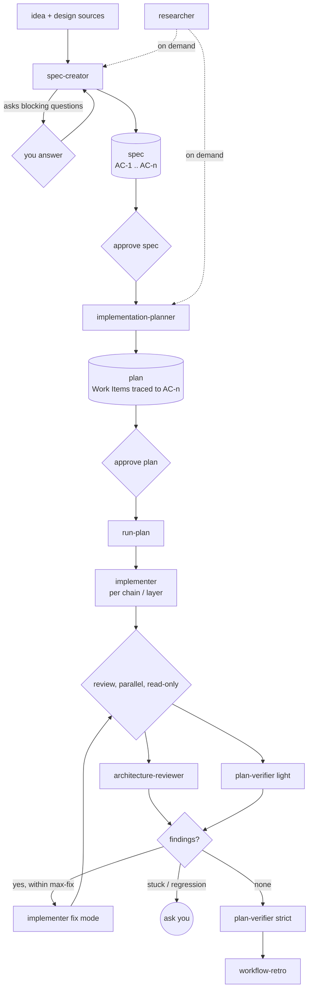

# sdd-engineering - Spec Driven Development Engineering

A set of four agents and two skills that take a feature from an idea to verified code in separate, reviewable steps:

1. **Spec** - `spec-creator` writes *what* the feature must do, as numbered, testable acceptance criteria.
2. **Plan** - `implementation-planner` turns an approved spec into *how*: Work Items with files, dependencies and acceptance criteria.
3. **Run** - the `run-plan` skill implements the approved plan, reviews it, and fixes findings in a bounded loop.
4. **Verify** - `plan-verifier` proves, with evidence, that every requirement of the plan is met.
5. **Retro** - `workflow-retro` looks back at the run and proposes concrete improvements.

The spec and the plan are written and approved by a human. Nothing is implemented from an unapproved plan.

## Install

```
/plugin marketplace add avelvi/dev-digest-marketplace
/plugin install sdd-engineering@dev-digest-marketplace
```

Installing this plugin automatically installs three dependencies (`^1.0.0`):

| Dependency | Why it is needed |
|---|---|
| [`engineering-paved-path`](../engineering-paved-path/README.md) | Architecture, React, Fastify, testing and security skills, loaded by the agents as `engineering-paved-path:<skill>` |
| [`research-tools`](../research-tools/README.md) | The read-only `researcher` agent, used by `spec-creator` to answer open questions |
| [`architecture-review`](../architecture-review/README.md) | The read-only `architecture-reviewer`, used by `run-plan` in its review phase |

## What is inside

| Component | Kind | What it does | Writes |
|---|---|---|---|
| `spec-creator` | agent | Analyses your design sources for gaps, interviews you about each one, then writes one spec in a fixed template with EARS acceptance criteria (`AC-n`) | the specs directory only |
| `implementation-planner` | agent | Reviews the requirements, asks whether to run single- or multi-agent, writes a Development Plan in which every `AC-n` is traced to a Work Item | the plans directory only |
| `implementer` | agent | Implements one Work Item (or a chain), or fixes a list of review findings. Never writes tests | source files within the Work Item's declared scope |
| `plan-verifier` | agent | Marks every Work Item and criterion Done / Partial / Missing with evidence (`file:line`, test name, command output). `light` mode checks code presence without running tests; `strict` requires passing tests | a JSON report |
| `run-plan` | skill (manual) | Orchestrates implement, parallel review and the fix loop for an approved plan | run state under the runs directory |
| `workflow-retro` | skill (manual) | Per-agent metrics, critical path, what was wasted, up to five proposals; appends to a ledger | the retro ledger only |
| `mermaid-diagram` | skill | Mermaid diagrams in Markdown; used by `spec-creator` and `implementation-planner` | - |
| `engineering-insights` | skill | Captures lessons from a session for the project's insights file, if it keeps one | the insights file, if present |

Agents are addressed by namespace: `sdd-engineering:spec-creator`, `sdd-engineering:implementation-planner`, `sdd-engineering:implementer`, `sdd-engineering:plan-verifier`. Skills are `/sdd-engineering:run-plan` and `/sdd-engineering:workflow-retro`.

## How the parts work together



The manual steps are these: you run `spec-creator`, approve its spec, run `implementation-planner`, approve its plan, and start `run-plan`. Everything between `run-plan` and its report is automated, and it hands control back to you when it is stuck.

| Step | Reads | Produces |
|---|---|---|
| `spec-creator` | feature description, design sources, existing code | `<specs>/YYYY-MM-DD-<slug>.md` (or a list of blocking questions, nothing written) |
| `implementation-planner` | the approved spec | `<plans>/<slug>.md` (or a "Needs input" report) |
| `run-plan` | the plan and its spec | code changes, `<runs>/<slug>/findings-<i>.md`, a run report |
| `plan-verifier` | the plan, the code, test results | `Done/Partial/Missing` report plus a JSON verdict |
| `workflow-retro` | the session (or transcripts with `deep`) | a chat report and one ledger entry |

## Quick start

```
Use the spec-creator agent to write a spec for "export a report as CSV". Design notes: docs/export.md
# review and approve the spec, then:
Use the implementation-planner agent to plan specs/2026-01-15-csv-export.md
# review and approve the plan, then:
/sdd-engineering:run-plan docs/plans/csv-export.md --check "npm test && npm run lint"
# afterwards:
Use the plan-verifier agent on docs/plans/csv-export.md
/sdd-engineering:workflow-retro
```

### `run-plan` arguments

```
/sdd-engineering:run-plan <plan-path> [--mode single|multi] [--max-fix N] [--tests] [--check "<command>"] [--runs-dir <dir>] [notes...]
```

| Argument | Default | Meaning |
|---|---|---|
| `<plan-path>` | required | The approved Development Plan |
| `--mode` | the plan's own mode | `single`: one `implementer` per chain in your checkout. `multi`: independent groups in parallel worktrees, merged afterwards |
| `--max-fix` | 2 | Review-and-fix iterations before handing back to you |
| `--tests` | off | Also run a `test-writer` agent, if your project has one |
| `--check` | taken from the project's `AGENTS.md` or `package.json` scripts | Command(s) run for the baseline and after each fix round |
| `--runs-dir` | `.claude/sdd-runs/` | Where run state is written (add it to `.gitignore`) |
| `notes` | none | Free text passed to every implementer. It never overrides the plan or an approved spec |

### Inputs and defaults

No path is hard-coded. Each agent takes locations from your request, then from the project's `AGENTS.md` or `CLAUDE.md`, then falls back to a default and says so in its report.

| Input | Default |
|---|---|
| specs directory | `specs/` (or `<module>/specs/` when the module has one) |
| plans directory | `docs/plans/` |
| run state | `.claude/sdd-runs/<slug>/` |
| plan-verifier report | `.claude/plan-verifier-report.json` |
| architecture rules and baseline | `.claude/architecture-review-rules.md`, `.claude/architecture-review-baseline.json` |
| retro ledger | `docs/retro/ledger.md` |

## The review and fix loop

- Findings from the reviewers are consolidated with stable ids (`F-n`) and split into **FIX** (architecture blockers, bugs with a concrete failure, code gaps found by the verifier) and **PARK** (advisory: reported, not auto-fixed).
- Fixes go to `implementer` in fix mode, exactly the listed findings, grouped by disjoint files. The check command is then compared with the baseline taken *before* implementation, so failures that already existed are not blamed on the run.
- Re-review is a recheck: the reviewers answer `RESOLVED` or `STILL OPEN` per id and only look at the files the fix touched.
- Control returns to you when `--max-fix` is reached, a finding is still open after two attempts (STUCK), or the number of FIX findings grows between rounds (REGRESSION).

## What your project should provide

| Needed | If missing |
|---|---|
| An `AGENTS.md` (or `CLAUDE.md`) describing modules and conventions | Agents infer the layout from the directory tree and say what they assumed |
| A check command (tests, types, lint) | Pass `--check`, or the baseline and fix loop cannot compare results |
| A git repository | `run-plan` needs it for snapshots and worktrees |
| Optional: `test-writer`, `code-review`, `pr-self-review`, `doc-writer` agents or skills | Skipped, and the report says so |

## Keeping token cost down

- All agents run on Sonnet; `run-plan` pins a cheaper model for itself.
- `plan-verifier` runs in `light` mode inside the loop; `strict` is the final gate.
- Chained Work Items go to one `implementer` instead of one agent each; worktrees are used only for genuinely parallel groups.
- Reviewers get a manifest of changed files, not the repository.
- Domain skills are loaded on demand from each Work Item's `Skills to use`, not preloaded.

## Limits

- It does not write product specs for you; `spec-creator` interviews you and you stay the author of intent.
- `implementer` never writes tests, and `plan-verifier` is not a code-quality review.
- "Mandatory" skill use is an instruction in the agent's prompt, not a technical gate.

## Source

Ported from <https://github.com/avelvi/dev-digest> (branch `dev`, commit `fae4c27`): `.claude/agents/`, `.claude/commands/implement.md` (now `run-plan`), `.claude/skills/workflow-retro`, `.claude/skills/mermaid-diagram`, `.claude/skills/engineering-insights`, `docs/sdd-workflow.md`. Project-specific paths, modules and commands were replaced by the inputs above.

## Evals

`evals/` holds cases for `claude plugin eval` (run from this directory with `claude plugin eval . --trust-plugin`). Results are written to `evals/results/`, which is git-ignored.

## Versioning

SemVer, tags `sdd-engineering--v<version>`. See [CHANGELOG.md](CHANGELOG.md). A breaking change in a dependency's skill names is a MAJOR release of that dependency, and this plugin bumps its range in the same pull request.
